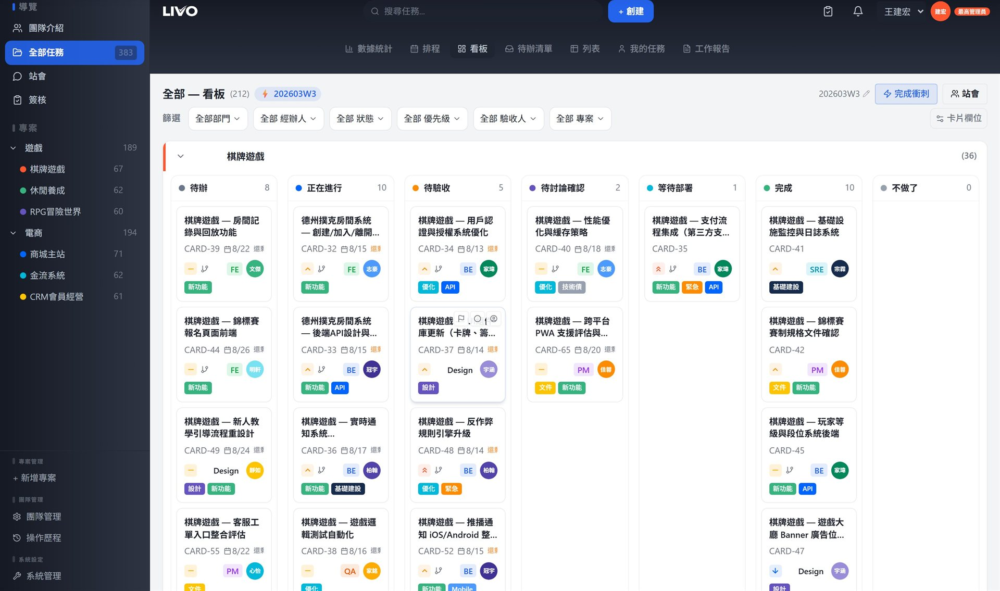
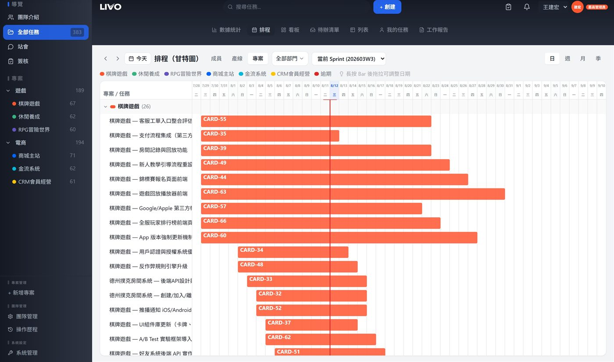
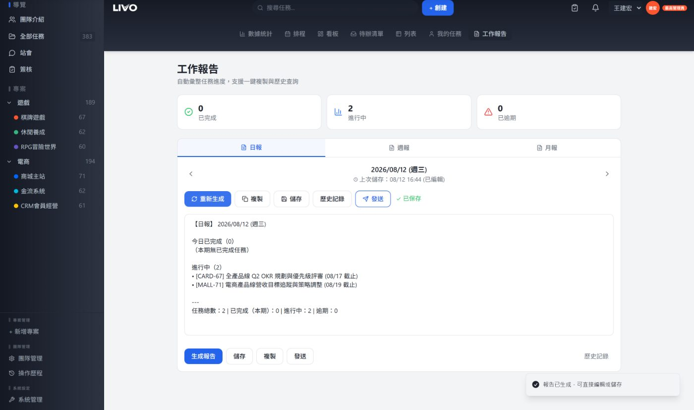
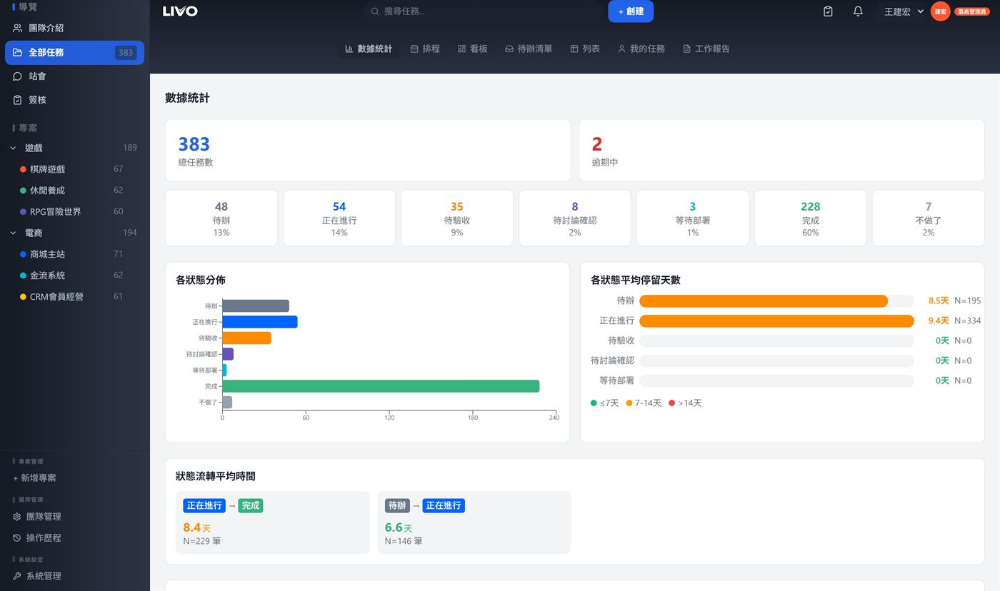
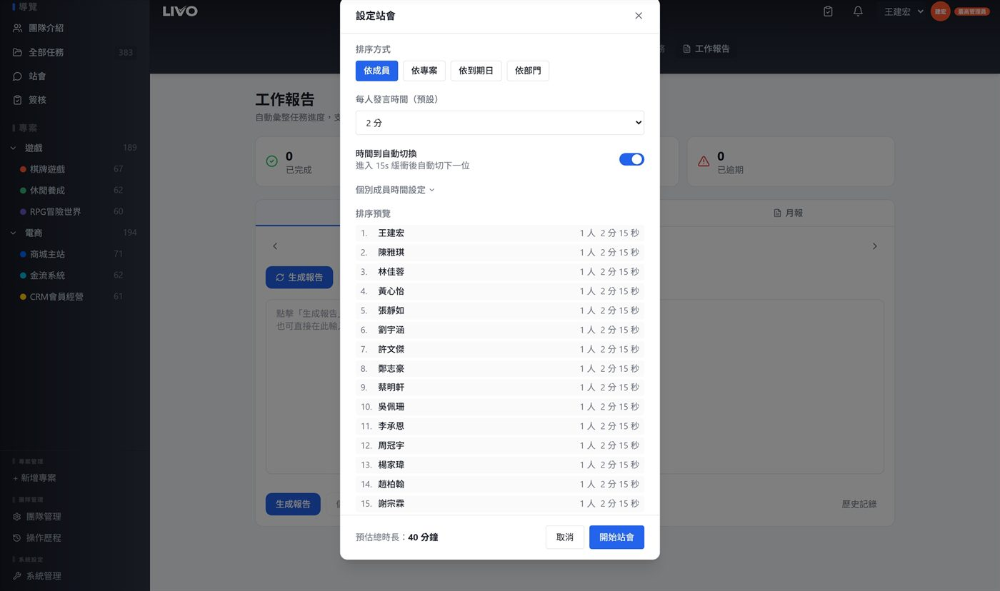

# LIVO

給中文團隊用的開源專案協作系統。把任務、知識與會議記錄、Bug 修復驗證、發布記錄放在同一套工作流程裡，從規劃、交接到驗收都能回到原始卡片與文件。

支援 Docker 自架（可在內網使用）與 Cloudflare 部署。以 [AGPL-3.0](LICENSE) 開源，自架版免費、不限成員人數、不需授權金鑰；QA、簽核、Slack 互動與發布等功能可按團隊需要啟用。

[English](README.en.md) · [線上試玩](https://livo-tw.com/demo/?demo=pro) · [官網](https://livo-tw.com) · [部落格](https://livo-tw.com/articles)

[](https://github.com/livo-tw/livo/actions/workflows/ci.yml)
[](LICENSE)



線上試玩不用註冊，資料只存在你的瀏覽器分頁裡，關掉就消失；展示模式不連接 Slack，也不能建立真實成員邀請。

## 功能

- **任務與 Sprint**：看板、列表、待辦清單、甘特圖與任務依賴；子任務、自訂與必填欄位、範本、狀態流轉、工時紀錄。未完成任務可帶入下一個 Sprint；指派與驗收責任立即生效，不需另行確認接單。
- **我的工作**：集中查看自己負責或驗收的任務、修復或測試的 Bug；個人側欄可調整產線與專案順序，不影響其他成員。
- **知識與會議記錄**：共用／專案頁面、三層目錄、富文字、搜尋、版本還原與留言；按角色、職稱或指定成員設定查看／編輯／留言權限，附件以登入權限下載。可保留私人草稿、確認發布文件版本，並把決議連到任務或 Bug。
- **文件匯入**：預覽並校對 Markdown、DOCX、PDF（含掃描檔 OCR）及明確允許的 Notion 頁面，再確認入庫；保留原始來源與來源版本。需要額外配置可選的私有解析服務。
- **QA Bug**：獨立看板與列表、RD／QA 負責人、自訂欄位與顯示流程、私人證據附件、修復與多環境部署驗證、跨部門交接。所有必要環境完成部署且最新正式驗證 PASS 後，自動結案。
- **部署與發布**：共用待部署清單彙整原任務和 Bug；發布批次整理跨專案／元件的版本、QA／UAT 證據、例外及人工部署、回滾、恢復記錄。
- **報告與站會**：依任務狀態整理日報、週報、月報，可編修、存歷史與排程送到 Slack；站會支援計時、分組、調整發言順序與臨時排除／恢復成員；另有儀表板與可選簽核流程。
- **協作與整合**：即時更新、欄位協作鎖、站內通知、Email（Resend）、Slack、Webhooks、個人 API Token。Slack 能力依部署方式與設定而異，見下方比較。
- **團隊管理**：成員與角色權限、一次性邀請連結、操作歷程、JSON 備份／匯出、Jira CSV 匯入；完整恢復需另外備份資料庫與附件。
- **介面**：繁體中文、簡體中文、English，深色／淺色主題，`Ctrl/Cmd + K` 快速搜尋；手機導覽與看板觸控操作。

| 甘特圖 | 工作報告 |
| --- | --- |
|  |  |
| **儀表板** | **站會** |
|  |  |

### 按需要啟用功能

管理員可在「系統管理 → 功能開關」管理簽核、QA Bug、Slack 互動、發布工作區與待部署清單。新安裝預設關閉這些可選功能；知識庫與一般任務不需要功能開關。關閉可選功能會保留其資料，Slack 及文件解析仍需各自完成服務設定。

邀請連結讓同事直接填寫姓名、Email 格式的登入帳號與密碼加入，不需確認信或寄信服務。每條連結只能使用一次，7 天到期，可由管理員撤銷；直接加入不代表已驗證該 Email 的所有權。

#### 簽核

到「系統管理 → 功能開關」開啟「簽核流程」，即可使用任務簽核、規則與通知。只有管理員與超級管理員可修改。Docker 與 Cloudflare 都支援，無須第三方服務或授權金鑰；展示模式 `?demo=pro` 預設開啟，僅使用瀏覽器內的模擬資料。

既有安裝若有簽核規則或申請，升級後仍保持開啟。關閉時會列出待簽核任務，管理員可取消或選擇「全部撤回並關閉」；撤回會清除任務的待簽核狀態並記錄操作。關閉後各頁面、狀態變更與通知都不再使用簽核。資料保留，重新開啟後可查看規則與歷史。設定透過既有 Realtime 同步；離線時於下次載入更新。Docker 升級請重跑安裝程式套用 migration，Cloudflare 請套用新版 `worker/schema.sql`。

### 工作流程與部署差異

QA 可直接調整工作狀態，也能正式記錄修復、部署及 PASS／FAIL／BLOCKED。手動選擇 PASS 或已結案只改工作狀態，不建立驗證證據；自動結案只由本輪所有必要環境的實際部署與最新正式 PASS 觸發。共用部署清單不另建任務，發布批次也不執行部署或自動更改任務／Bug 狀態。

知識頁與會議記錄可以建立／連結任務或 Bug，並保留來源頁面與段落；文件檢查項不會替代任務完成或 QA 驗證。頁面權限受上層限制，管理員不會自動取得受限頁面的查看權。

| 能力 | Docker 自架 | Cloudflare |
| --- | --- | --- |
| 任務、知識與會議、QA、部署清單、發布資料 | 支援 | 支援 |
| 一般任務 Slack 私人面板、建卡與留言 | Socket Mode；需 Bot、App Token 與對外連線 | 未提供此一般任務互動入口 |
| QA Slack 操作與 Bug 討論串同步 | Socket Mode，需設定事件與權限 | 簽名 HTTP 入口，需設定 Signing Secret 與事件 |
| Slack 知識搜尋 | 既有 Socket Mode relay | 簽名 HTTP 入口 |
| Slack 發布批次確認與配送 | 需配置既有整合與頻道路由 | 一般 D1 登入身份未支援 |
| 文件解析／OCR | 選用內部處理器，預設關閉 | 另配置可信私有處理器，Workers 不直接執行解析程式 |

Docker 的 `/livo` 開啟私人任務面板；`/livo new 標題` 建卡、`/livo comment ABC-123` 留言、`/livo context ABC-123` 查看任務背景與需求。QA 使用 `/livo bug ...`，知識搜尋使用 `/livo kb 關鍵字`。每次操作依目前成員與資料權限檢查；手動帳號對應限超級管理員，成員可解除自己的 Slack 連結。

任務通知可按產線／專案指定頻道，使用持久佇列、去重與限流重試；無法確認送達的結果保留待查。Socket Mode 不需內網提供公開 Request URL，但仍需允許對外 HTTPS／WebSocket。新增程式碼不會自動設定真實 Slack App，升級後需在自己的環境完成設定與驗收。

### 文件導航

- [Docker 安裝、升級與 Slack 設定](release-template/README.md)
- [任務責任與 Slack 面板](docs/task-work-slack.md) · [期限與到期提醒](docs/task-planning-slack.md)
- [知識與會議工作流程](KNOWLEDGE-WORKFLOW.md) · [頁面權限](docs/knowledge-permissions.md) · [私有文件匯入](docs/knowledge-import.md)
- [QA Bug 與 Slack](QA-WORKFLOW.md) · [QA、自動結案與共用部署清單](docs/qa-slack-and-deployment-workflow.md)
- [發布批次與討論串](release-template/README.md#跨卡發布批次與持續討論串) · [使用情境與部落格文章](https://livo-tw.com/articles)

## 開始使用

有三種方式，挑一種就好。

### 1. 在自己電腦上跑起來（開發模式）

需要 Node.js 22 以上。後端用 Cloudflare 的 `wrangler dev` 在本機模擬資料庫與檔案儲存，不需要 Cloudflare 帳號。

```bash
git clone https://github.com/livo-tw/livo.git livo
cd livo
npm ci

# 後端
cd worker
npm ci
cp .dev.vars.example .dev.vars      # 把 JWT_SECRET 改成一串夠長的隨機字
npm run db:migrate:local            # 建立本機資料庫
npm run db:seed:local               # 示範資料：20 位虛構成員，密碼都是 test1234
npm run dev                         # API 跑在 http://localhost:8787

# 前端（另開一個終端機，回到 repo 根目錄）
cp .env.example .env.development
npm run dev                         # 打開 http://localhost:5173/demo/
```

用 `admin@livo.test` / `test1234` 登入。不想要示範資料的話，把 `npm run db:seed:local` 換成下面這行，會建立空白的系統和你自己的管理員帳號（密碼只顯示一次）：

```bash
node scripts/init-instance.mjs --local --email you@example.com --name 你的名字
```

### 2. Docker 自架（資料存放在自己的伺服器）

適合放在公司內網或自己的伺服器。需要 Docker（含 Compose），打包安裝包的那台電腦需要 Node.js 22 以上。

```bash
git clone https://github.com/livo-tw/livo.git livo
cd livo
npm ci
node scripts/build-release.mjs      # 產生 release/livo-release/（Linux/macOS 需要 zip 指令）

cp -R release/livo-release ~/livo   # 裝在 repo 外面，之後重新打包不會動到它
cd ~/livo
sh install.sh                       # Windows：把資料夾複製出來後，對 install.bat 點兩下
```

安裝程式會為這套安裝產生專屬的金鑰與密碼、匯入資料庫結構，再請你建立第一位管理員。完成後打開 <http://localhost:3000/>。詳細說明、日常維運與疑難排解在 [release-template/README.md](release-template/README.md)，其中也有：

- **升級到新版**：把新版檔案蓋到原本的安裝資料夾（保留 `docker/.env`），重新執行安裝程式；新增的資料庫更新會先自動備份再套用，不會刪資料。
- **用 API 金鑰操作 LIVO**：讓 AI 或腳本透過 API 讀寫資料，權限等同金鑰綁定的成員，不需要伺服器或資料庫權限。

### 3. 部署到 Cloudflare

後端用 Workers + D1 + R2 + Durable Objects，前端用 Pages。先在 `worker/` 登入：`npx wrangler login`。

```bash
cd worker
npx wrangler d1 create livo-db              # 把印出的 database_id 貼進 wrangler.jsonc
npx wrangler r2 bucket create livo-attachments
npx wrangler secret put JWT_SECRET          # 貼上一串夠長的隨機字
npm run db:migrate:remote
node scripts/init-instance.mjs --remote --email you@example.com --name 你的名字
npx wrangler deploy                         # 記下 API 網址，例如 https://livo-api.<帳號>.workers.dev

cd ..
VITE_API_URL=https://livo-api.<帳號>.workers.dev VITE_LOCAL_MODE=false npx vite build --outDir dist
mkdir -p site/demo && cp -r dist/* site/demo/
printf '/demo/*  /demo/index.html  200\n' > site/_redirects
npx wrangler pages deploy site --project-name livo
```

最後把前端網址（例如 `https://livo.pages.dev`）加進 `worker/wrangler.jsonc` 的 `ALLOWED_ORIGINS`，並設好 `APP_BASE_URL`、`API_BASE_URL`，再跑一次 `npx wrangler deploy`。要寄 Email 通知就再設定 `RESEND_API_KEY`（說明在 `wrangler.jsonc` 最後）。

## 技術架構

| | |
| --- | --- |
| 前端 | React 18、TypeScript、Vite、Tailwind CSS（shadcn/ui）、TipTap 編輯器 |
| 後端（Cloudflare） | Workers（Hono）、D1（SQLite）、Durable Objects（即時同步）、R2（附件） |
| 後端（Docker） | 自架 Supabase：Postgres、PostgREST、Realtime、Edge Functions |
| 登入 | 自建 JWT（access 1 小時、refresh 30 天並輪替），密碼用 PBKDF2 |

```
src/                    前端
worker/                 Cloudflare Worker 後端（schema.sql、seed.sql、設計說明 DESIGN.md）
docker/                 Docker 自架版（Supabase 設定與 edge functions）
supabase/migrations/    Docker 版的資料庫結構
release-template/       Docker 安裝程式與部署說明
scripts/build-release.mjs  產生 Docker 安裝包
```

## 目前的限制

- 從原始碼執行（`npm run dev`）或部署到 Cloudflare 時，網址在 `/demo/` 路徑下；Docker 安裝版在網站根目錄（例如 `http://localhost:3000/`）。
- Jira CSV 匯入支援英文與簡體中文欄位別名；其他欄位名稱需先轉換。附件搬遷使用另附的 `scripts/jira-attachments.mjs` 工具，不會只靠 CSV 自動搬入。
- 文件匯入需私有解析服務與相應權限；每份來源最多 10 MB、PDF 最多 40 頁。掃描檔 OCR 與不支援的格式會顯示校對提示，Notion 子頁需逐一允許與選取。
- JSON 備份不等於完整伺服器備份，私有知識與檔案的涵蓋範圍以備份清單為準；部分還原／跨資料庫搬遷會被保護規則阻擋。完整恢復應使用資料庫與檔案儲存備份，QA 附件不會自動跨 Docker／R2 搬遷。
- Slack、Email、Webhooks 會將所設定的通知內容送到外部服務；不使用這些整合時可維持內網運作。一般任務與 QA 的 Slack 討論串同步範圍不同，設定與限制見上方文件。
- 介面文字以繁體中文最完整，簡中和英文有部分畫面還沒翻譯。

## 授權

LIVO 以 [GNU AGPL-3.0](LICENSE) 釋出。你可以免費使用、修改、商用。如果你修改了程式，再透過網路提供給其他人使用，就要把修改後的原始碼提供給那些使用者。自己公司內部架來用、沒有改程式碼，不需要做任何事。

需要 AGPL 以外的授權條款（商業授權），或需要付費的導入服務（代部署、Jira 搬遷、教育訓練、年度支援），價格與聯絡方式在 <https://livo-tw.com/pricing>，也可以來信 service@livo-tw.com。

## 參與開發

歡迎開 issue 或送 PR，請先看 [CONTRIBUTING.md](CONTRIBUTING.md)。第一次送 PR 需要簽署 [CLA](CLA.md)。安全性問題請依 [SECURITY.md](SECURITY.md) 私下回報，不要開公開 issue。

## 作者

Lingye，台灣的個人開發者，做了十年 PM。LIVO 一開始是做給自己團隊用的工具。
